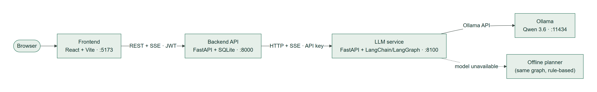
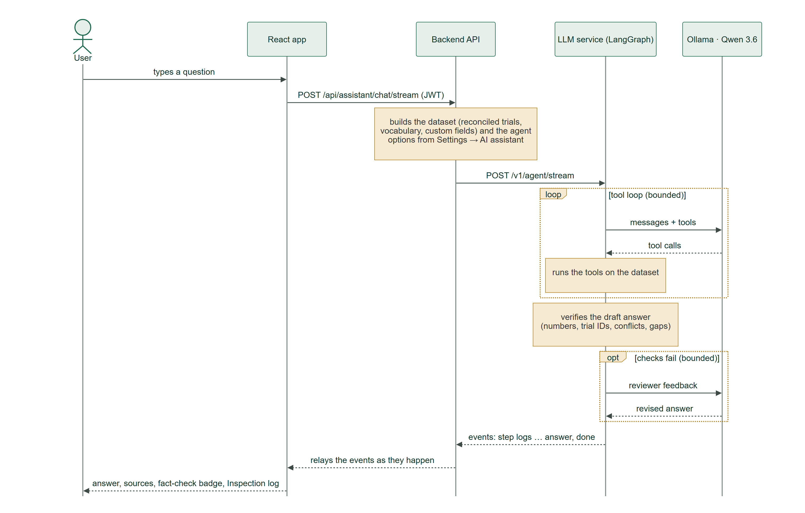
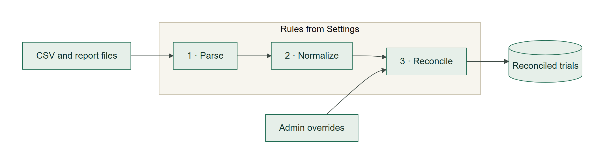
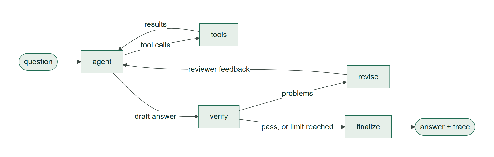
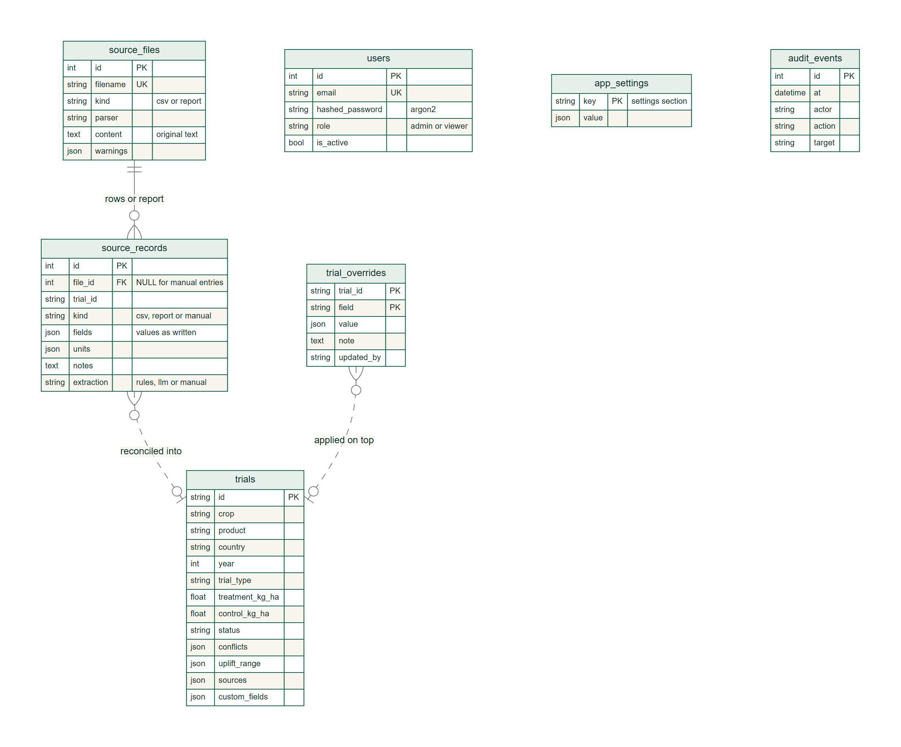

# AgriEvidence – what it does and how it works

AgriEvidence is an agricultural trial evidence platform. It reads trial results that arrive as spreadsheets and free-text reports, and turns them into **one reconciled record per trial**. Each record shows where every value came from and where the sources disagree.

On top of those records you can do three things:
- **filter and compare** trials, with charts;
- **ask questions in plain language** to an AI assistant, a LangGraph agent running Qwen 3.6 in Ollama, which checks its own numbers against the data;
- **manage** users, trials and every rule of the process in the settings, as an admin.

This document explains what the app does and how. To install and run it, see [README.md](README.md). The deck covers the same story in slide form.

The diagrams are PNG images in [`docs/diagrams/`](docs/diagrams/). Each one is rendered from the Mermaid source (`.mmd`) beside it, which you can edit and re-render with any Mermaid tool, e.g. <https://mermaid.live>.

---

## 1. The problem it solves

Trial results rarely arrive clean. The provided sample data (`sample-data/`) shows the typical issues:

| Issue | Example from the sample data |
| --- | --- |
| Different file layouts | `trials_a.csv` uses `trial_id, crop, …`; `trials_b.csv` uses `Trial reference, Crop name, Season year, Treated yield kg per ha …` |
| Free-text reports | `T03_summary.txt`: "Treated yield: 44 t/ha. Control yield: 40 t/ha." |
| Spelling variants and codes | `Harvest Plus` / `HarvestPlus` / `HARVESTPLUS`, `potato` / `potatoes`, `FR` / `DE` / `ES` |
| Mixed units | `7800 kg/ha` in one file, `7.8 t/ha` in another |
| Conflicting values | T03's treated yield: 42 t/ha in `trials_a.csv`, 44 t/ha in `T03_summary.txt` |
| Gaps | T05 has no control yield; T06 appears only in an archive note |

On these raw files you can't compute an average, and a naive merge would hide the conflict. AgriEvidence reconciles the data but keeps the conflict and the gaps visible, so nobody draws a conclusion the evidence doesn't support.

## 2. What the app does

### For everyone (viewers and admins)

- **Dashboard:**
  - filters (crop, product, country, year, trial type, data status, and custom fields);
  - summary tiles: trials, mean uplift vs control, open conflicts, trials that need attention;
  - a mean-uplift chart by product, crop, country or trial type;
  - the trials table.
- **Trial detail:**
  - the reconciled values and the yield uplift, plus the range of uplift when sources conflict;
  - every source with the values it reported, and a viewer for the original file;
  - conflicts, caveats and notes.
- **Compare (2 to 6 trials by default):**
  - summary tiles; tied trials are named together;
  - warnings, such as different crops or conflicting sources;
  - an uplift chart with conflict ranges, and a treated-vs-control chart with one axis per crop;
  - a field-by-field table that highlights differences;
  - a table view behind every chart.
- **Evidence Assistant:**
  - a chat that streams answers as Markdown;
  - each answer lists the trials and sources it used, shows whether it passed the fact-check, and names the model that answered;
  - an **Inspection** tab that shows every step of the agent.

### For admins only

- **Users:** add users, change roles, deactivate accounts, reset passwords, and allow or block self sign-up.
- **Trials:** add trials by hand or by uploading spreadsheets and reports (Add New Trial → Upload files), edit, delete and restore them, and resolve conflicts by choosing a value.
- **Data:**
  - import CSV/TSV files and text reports, with a preview that saves nothing;
  - remove files and rebuild all trials;
  - reset the demo.
- **Settings:** custom fields, reference data, display and comparison, import and reconciliation rules, and the AI assistant (see §7).
- **Activity log:** who changed what, and when.

The API enforces every admin rule, not just the screens.

## 3. How it is built

| Part | Folder | Responsibility | Main technology |
| --- | --- | --- | --- |
| Frontend | `Agricultural_Trial_Evidence_App_Frontend` | Everything the user sees; the offline demo when no backend is configured | React 19, TypeScript, Vite, Tailwind, Jotai, Zustand, Zod, hand-written SVG charts |
| Backend API | `Agricultural_Trial_Evidence_App_Backend` | Accounts and roles, import, reconciliation, settings, comparison, the audit log; owns the database | FastAPI, SQLAlchemy, SQLite, JWT, argon2 |
| LLM service | `Agricultural_Trial_Evidence_App_LLM` | The assistant's agent and the report extraction loop; stateless | FastAPI, LangChain, LangGraph, langchain-ollama |
| Ollama | external | Runs Qwen 3.6, on the same machine or a GPU server | Ollama |

Each app folder is a standalone project with its own dependencies and tests. The backend has no LangChain dependency; it talks to the LLM service over HTTP only.

### What happens when someone asks a question

## 4. From files to trials

1. **Parse.**
   - CSV/TSV: the delimiter is detected, and headers are matched to fields through configurable aliases. Case, spacing and unit words are ignored, so `Treated yield kg per ha` becomes the treated yield in kg/ha.
   - Reports: `Label: value.` sentences, headings and notes are read.
   - A report that misses required fields goes to the LLM service's **extraction loop**, if enabled.
   - Values are stored exactly as written, with their source file and row.
2. **Normalize.**
   - Names, aliases, plurals and codes map to one vocabulary: `HARVESTPLUS` → Harvest Plus, `potatoes` → Potato, `DE` → Germany.
   - Yields are converted through kg/ha to the display unit: 1 t/ha = 1000 kg/ha.
3. **Reconcile** each trial across its sources:
   - Values within a tolerance (0.5 % by default) count as equal.
   - When sources disagree, both values are kept and the trial is flagged as a **conflict**. The field is then filled by the conflict strategy:
     - the highest-priority source (manual → CSV → report by default);
     - the mean;
     - or left open for an admin.
   - Uplift = (treated − control) ÷ control × 100, rounded to 0.1 %. For a yield conflict, the **uplift range** shows the lowest and highest uplift the sources allow.
   - Caveat rules turn sentences in the notes into caveats. "Replication details … are unavailable" becomes *Replication not documented*.
   - Every trial gets one status, checked in this order:
     1. `conflict` (an open disagreement);
     2. `incomplete` (a core value such as a yield is missing);
     3. `manual` (entered by an admin, no document);
     4. `single_source`;
     5. `consistent`.
4. **Override.**
   - Admin edits, conflict resolutions and deletions are stored separately, with who made them and why.
   - They are applied on top of the sources on every rebuild, so re-imports never undo them.

Saving the reference data, custom fields, import rules or reconciliation rules re-parses the stored files, so a rule change applies to existing data too.

**The sample data, reconciled** (yields in t/ha):

| Trial | Product · crop | Treated | Control | Uplift | Status |
| --- | --- | --- | --- | --- | --- |
| T01 | Harvest Plus · Wheat | 8.4 | 8.0 | +5.0 % | consistent (trials_a + trials_b) |
| T02 | Harvest Plus · Wheat | 7.8 | 7.5 | +4.0 % | consistent (CSV in kg/ha + field report) |
| T03 | Root Boost · Potato | 42 | 40 | +5.0 %, range +5.0 to +10.0 % | **conflict**: 42 vs 44 t/ha |
| T04 | Root Boost · Potato | 45 | 45 | 0.0 % | consistent |
| T05 | Harvest Plus · Wheat | 8.1 | – | – | incomplete (no control yield) |
| T06 | Harvest Plus · Wheat | 6.6 | 6.0 | +10.0 % | single source (archive note) |

## 5. The Evidence Assistant

The assistant is a **LangGraph state machine with two loops**:

- **Tool loop** (`agent ⇄ tools`):
  - The model, with six LangChain tools bound, decides what to look up. It repeats until it has the evidence.
  - The number of model calls per round is limited. When the limit is reached, the model must answer without tools.
- **Reflection loop** (`verify → revise → agent`):
  - Every draft is checked **deterministically**, not by another model:
    - every number appears in the tool results (rounding and unit conversion allowed);
    - every trial ID exists;
    - conflicts and missing controls of the cited trials are disclosed;
    - data answers are based on tool calls.
  - Failed checks go back to the model as reviewer feedback, a limited number of times. An answer that still fails carries a visible note.

| Tool | What it returns |
| --- | --- |
| `search_trials` | Trials matching filters (one value or a list per field, a year or a range of years) or free text; spelling variants are resolved |
| `get_trial_details` | One trial with every source's values, its conflicts, notes and caveats |
| `trial_statistics` | Mean, median, min and max uplift (ties list every trial), excluded trials, the conflict range, and an optional ranking by a field |
| `compare_trials` | Fields that differ, a ranking by uplift (ties share a place), and warnings |
| `find_data_issues` | Conflicts, missing values, single-source trials, caveat counts |
| `list_reference_data` | Products, crops, countries, years and types with their variants, plus the custom fields |

An excerpt of a real answer, for "What is the average yield uplift of Harvest Plus on wheat?":

> **Harvest Plus on Wheat**: mean yield uplift **+6.3%** across 3 trials with a control yield (range +4.0% in T02 to +10.0% in T06).
>
> T05 (Germany, 2025, Demonstration): treated 8.1 t/ha, control yield missing, so uplift can't be calculated · trials_b.csv

**Offline planner.**
- `RuleBasedChatModel` is a LangChain chat model that plans tool calls with rules and writes answers from templates.
- Like the model, it picks its next step from the results. When a combination finds nothing, it searches each part separately ("Harvest Plus has only been trialled on Wheat"). For evidence questions, it reads conflicting trials in full to quote their sources.
- It runs inside the **same graph**, with the same tools and the same checks.
- The service uses it when Ollama or the model is unavailable, or when a model call fails mid-run.
- Admins can force it with *Settings → AI assistant → Always use the offline planner*. That is useful for a presentation without a GPU.

**Report extraction loop** (`extract → validate → extract`):
- For reports the rules can't read, Qwen fills a structured schema.
- The values are then validated against the text: the trial ID appears, the yields are copied exactly, the year is plausible, and the unit is known.
- Problems go back to the model for another attempt, up to a limit.

## 6. Data model

- **source_files** and **source_records** are the evidence. Files keep their original text, and records keep each trial exactly as one source wrote it.
- **trials** is derived. It is rebuilt from the records, the overrides and the settings whenever any of them change. Yields are stored in kg/ha and converted for display, and uplift is computed by the API.
- **trial_overrides** hold admin decisions per trial and field. A deleted trial keeps an `__excluded__` marker, so a re-import can't revive it.
- The links from records and overrides to `trials` are by value, not foreign keys, because those rows must outlive the derived table.

The full, commented DDL is in [`Agricultural_Trial_Evidence_App_Backend/docs/schema.sql`](Agricultural_Trial_Evidence_App_Backend/docs/schema.sql). It builds a database identical to the one the app creates.

## 7. Roles, security and settings

- **Accounts and roles:**
  - Passwords are hashed with argon2, and sign-in returns a JWT.
  - Every request re-checks the user, so a deactivated account stops working at once.
  - Admins can't lock themselves out, and the last admin is protected.
  - Self sign-up creates viewers only, and is off by default.
- **Audit:** every admin action is logged with the actor, the target and a summary.

Everything an admin is likely to change lives in **Settings**, not in code:

| Settings tab | What it controls |
| --- | --- |
| Users & access | Users and roles, self sign-up |
| Trials & data | Add trial, imports with preview, source files, deleted trials, rebuild, reset demo |
| Custom fields | Extra trial fields: text, long text, number, select, yes/no or date. Each has a unit, options, a required flag, placement (table, filters, compare, charts) and the CSV headers that hold it |
| Reference data | Crops, products, countries (with codes), trial types (with colors), units (factor to kg/ha) and their spelling variants; strict vocabulary for manual entries |
| Display & compare | App name, yield unit, decimals, table columns, comparison limit, charts and fields |
| Import rules | Header aliases, default unit, LLM extraction, tolerance, conflict strategy, source priority, caveat rules |
| AI assistant | Model and Ollama address, temperature, context window, thinking mode, tool-loop and reflection limits, fallback, "always offline", memory, extra instructions, suggested questions, a model test and a diagram of the loops |
| Activity | The audit log |

## 8. Demo mode

Demo mode is on by default (`DEMO_MODE=true` in the backend). The presentation never depends on extra infrastructure:
- the demo accounts (`admin@agrievidence.demo` / `admin123`, `viewer@agrievidence.demo` / `viewer123`) are listed on the login page;
- the sample data is imported on first start;
- **Reset demo** restores the first-run state;
- without Ollama, the offline planner answers through the same graph;
- without the backend, the frontend's dev server offers an **offline demo** with the sample trials in the browser.

## 9. Quality and limitations

- **Tests:**
  - LLM service: 86 pytest tests covering the loops, fallbacks, fact-checks, small-model guards, API and the client brief's example requests.
  - Backend: 65 pytest tests covering import, reconciliation, roles, trials, settings and the assistant relay.
  - Frontend: type-check, lint and production build.
  - The main journeys were driven in a real browser as admin, as viewer and in the offline demo.
- **Real model:** `qwen3:1.7b` runs end to end on the development laptop's CPU, at 1–4 minutes per answer, with the small-model guards described in the LLM README.
- **Not yet verified:** Qwen 3.6 itself. It needs roughly 17–24 GB of memory, and the development machine has 7.3 GB. On a bigger machine, *Settings → AI assistant → Test the model* confirms it.
- **Not yet done:**
  - version control for the three repositories;
  - a production deployment (database, HTTPS, real accounts with `DEMO_MODE=false`).
